# Component separations between 1023 and 1523 MHz: frequency evolution of profile width

**Status: 2026-10-16.** MeerKAT L-band, pulsars with drifting subpulses or P3 modulation (Song et al. 2023).
Repository `github.com/aszary/spats`, branch `claude`. Canonical result file: `input/separations.csv` (193 pulsars).

This document describes what was measured, how, and what came out. It replaces
`profile_narrowing_summary.md` as the main reference; that file and the chronological log
`separations_analysis_log.md` remain for the details. All numbers below are recomputed on the
193 pulsars in `input/separations.csv`, so they differ slightly from the older summary
(which used 195 rows, see §3.6).

---

## Key results

| | |
|---|---|
| Sample | **193 pulsars** with a measured change of component separation (533 in the parent sample) |
| Profiles narrower at 1523 MHz | **124 / 193 (64%)**, binomial p = 9×10⁻⁵ |
| Median ΔW/W | **−0.024**, 68% CI [−0.028, −0.016] |
| Implied spectral index of the separation, W ∝ ν^−a | **a = +0.058**, 68% CI [+0.036, +0.063] |
| Edges | leading component moves later, trailing moves earlier; common shift consistent with zero → **not a DM or alignment error** |
| Population scatter vs. errors | robust σ = 0.071 against a median error of 0.021: the pulsar-to-pulsar spread is real |
| Ė dependence | ρ_S = +0.22 (p = 0.002) over all, but on the independent batch sample only ρ_S = +0.19, **p = 0.056**: **not confirmed** |
| New (exploratory) | Song+23 drifters narrow, P3-only pulsars do not (Mann–Whitney p = 0.007), **but the two groups differ in Ė; with Ė controlled, p ≈ 0.05** |
| New (diagnostic) | the dominant batch failure (184 pulsars) is a **Gaussian-fit failure, not misaligned data**: low and high profiles agree to 0.3 bin. These pulsars can probably be recovered with a better fitting method |

---

## 1. Data

### 1.1 Parent sample

533 pulsars from `input/pulsars.txt`, which is the Song et al. (2023) sample of pulsars showing
subpulse drift or P3 modulation in MeerKAT Thousand-Pulsar-Array observations. Each has a directory
`~/output/claude/<PSR>_16/` (container: `/home/psr/output/<PSR>_16/`). Typical observation:
1024 phase bins, ~1000–1100 single pulses, L-band receiver.

### 1.2 Sub-bands

The archive `pulsar.spCf16` has 16 frequency channels (hence the `_16` suffix).
`Data.multifrequency_split` zeroes channels (`paz -Z`) and scrunches each sub-band to a single
channel (`pam -F`):

| sub-band | channels kept | file | typical centre |
|---|---|---|---|
| low | 0–2 | `pulsar.low` | ~1023 MHz |
| mid | 7–8 | `pulsar.mid` | ~1284 MHz |
| high | 13–15 | `pulsar.high` | ~1523–1540 MHz |

The centres are **not the same for every pulsar**: they depend on the observing setup and on how
many channels RFI removed (e.g. 949/1631 MHz for some observations). Each pulsar's own `nu_low`
and `nu_high` are stored in `input/separations_merged.csv` and are used for the spectral index (§4.4).

### 1.3 P3-folds

For each sub-band: baseline removal (`pmod -debase`, which also gives the on-pulse window
`bin_st`–`bin_end`), LRFS/2DFS to obtain P3, then folding the single pulses with P3 into
`p3_ybins` drift-phase bins (`p3fold_norefine`, PSRSalsa ASCII). The result is a
`p3_ybins × 1024` "average drift cycle": a few to a few tens of high-S/N profiles instead of
~1000 noisy single pulses. Parameters are in `params.json`. **The `norefine` fold is used
throughout.** 471 of the 533 pulsars have usable low and high P3-folds, so re-measuring the
separations never touches the raw data in `~/data`.

---

## 2. Measurement

### 2.1 Gaussian fits per P3-fold row

For **every row of the P3-fold separately** (every drift phase) and **in each sub-band separately**,
`n_comp` Gaussians plus a constant are fitted inside the on-pulse window
(`GaussianFit.fit_gaussians`). The components are then **sorted by position**
(`GaussianFit.component_offsets`), so G1 is always the leftmost one.

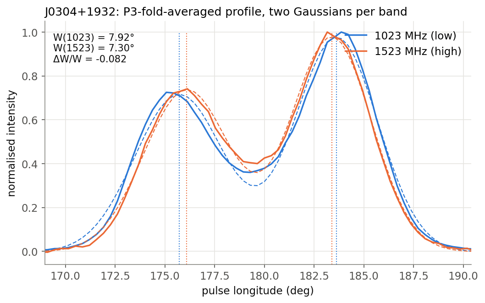

*Figure 1. J0304+1932, the P3-fold rows averaged into one profile per band, with a two-Gaussian
fit (dashed) and the fitted centres (dotted). The outer components move towards each other at
the higher frequency: W drops from 7.92° to 7.30°, ΔW/W = −0.082. The real measurement fits each
row and averages the offsets (§2.3); for this pulsar it gives −0.082 as well.*

### 2.2 Quantities

For component *i*:

```
offset_i = μ_i(1523) − μ_i(1023)                    [deg]
μ_i      = (μ_i(1523) + μ_i(1023)) / 2              mid-band position
```

Only the **first and last** components are used:

```
W      = μ_last − μ_first                           outer-component separation, mid-band [deg]
Δsep   = offset_last − offset_first = W(1523) − W(1023)
ΔW/W   = Δsep / W                                   dimensionless; < 0 means narrower at 1523 MHz
```

**Why a difference of offsets.** A residual DM error or a misalignment of the sub-bands shifts the
whole profile by the same amount; this cancels in Δsep (cf. Hassall et al. 2012). A single
component offset does not have this protection.

**Why divide by W.** The absolute change scales with profile width (§4.2), so Δsep in degrees
mostly encodes how wide the profile is. ΔW/W compares directly between pulsars.

### 2.3 Averaging over rows

For each component the offsets of all kept rows are combined as a weighted mean with weights
1/σ². The quoted error is **σ_ext**, the error scaled up by the row-to-row scatter, because that
scatter, not the formal fit error, limits the measurement. Results are written by
`Plot._offset_summary` to `input/separations.csv`
(`Nazwa, ncomp, lon 1..4, lon err, sep, sep err, dsep, dsep err`).
A row with `err = NaN` or `0` is dropped per component (before 2026-09-17 a single such row turned
the whole pulsar into NaN).

### 2.4 Number of components

`n_comp` is not stored in `params.json`. Two automatic selectors were tested on 105 pulsars with
known `n_comp`: a peak counter (61% correct) and BIC over 1–4 Gaussians (58%). Neither beats the
constant `n_comp = 2` (79%; consensus of both under 2-fold cross-validation: also 79%, McNemar
p = 0.42). The reason: `n_comp` is the number of components that can be **tracked through the
P3-fold**, and the scrunched profile that a selector looks at throws away exactly that drift
information. **The batch uses `n_comp = 2` for everyone**; a wrong choice shows up later as merged
components or high χ². The final sample has 177 pulsars with 2 components, 15 with 3 and 1 with 4.

---

## 3. Quality control and sample

### 3.1 Campaign 1 (106 listed pulsars)

The list `input/separations_todo.csv` was processed by hand, supported by a numerical
criterion: **91 measured, 15 rejected**. Fixes made along the way:

- the NaN propagation in `_offset_summary` described in §2.3;
- `dsep` was computed but not saved: the columns `dsep, dsep err` were added and the 91 rows
  recovered from the logs (validated: `sep` from the log equals the CSV row to 10⁻⁴ deg, 91/91);
- 21 values in the older `offsets.csv` turned out to be outdated, including artefacts:
  J1733−3716 −12.208° → −1.827°, J1714−1054 −2.241° → −0.944°, and sign flips for
  J1757−2421, J1803−3329, J1807−0847, J1824−0127, J1825−0935.

### 3.2 Batch (380 remaining pulsars)

`~/claude/work/scripts/batch_run.jl` calls `Plot.analyse_p3folds4_agent`, the non-interactive
variant (the plain `analyse_p3folds4` waits for a key press). The run takes ~20 minutes.
Gates:

| gate | threshold | reason |
|---|---|---|
| outlier rows | median + 4·MAD of max\|Δμ\| | real offsets can be large (J1843−0459: 11 bins), so the cut must be adaptive |
| low/high fit mismatch | median \|Δμ\| > 10 bins | the adaptive cut cannot catch a failure affecting *all* rows; healthy pulsars have 0.2–4.9 bins |
| too few rows | < 5 kept | |
| merged components | W < 1.0° or W/σ_W < 5 | minimum among the 91 verified pulsars: W = 2.61° at 8.8σ |
| extreme value | \|ΔW/W\| > 0.4 | maximum among the 91 verified: 0.32 (added after the run, see §3.6) |

| batch status | pulsars |
|---|---|
| low/high fit mismatch | 184 |
| passed, sent to review | 102 |
| passed, clean | 47 |
| too few rows | 26 |
| merged components | 21 |

### 3.3 What the "low/high fit mismatch" actually is (new)

Half of the batch was lost at this one gate. Since a common shift of the whole profile cancels in
Δsep (§2.2), it matters whether the gate catches misaligned data (harmless for Δsep) or failed fits
(harmful). The test: cross-correlate the scrunched low and high profiles of every batch pulsar
inside the on-pulse window (`scripts/offsets_doc_misalign.py`).

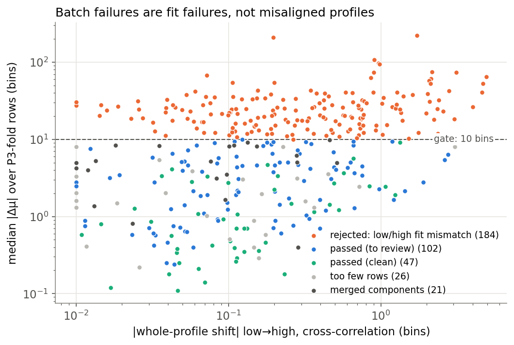

*Figure 5. Median |Δμ| over P3-fold rows (the gate quantity) against the whole-profile shift
between the bands. Shifts below 0.01 bin are drawn at 0.01.*

The profiles are aligned in **all** 380 cases: the median |shift| is 0.33 bin for the rejected
pulsars and 0.11 bin for the accepted ones, and **none** of the 184 exceeds 5 bins. Their median
|Δμ| is 23 bins, about 19% of the on-pulse window. So the gate removes cases where **the
Gaussians land on different features in the two bands**, a fit and labelling failure. It does
its job, but these 184 pulsars do not lack signal. A method that does not fit the bands
independently (a joint fit with shared component identity, or template / FFTFIT-type
matching, see `component_position_methods.md`) could recover a large part of them.

### 3.4 Manual review of 123 pulsars

Instead of ~1500 per-row figures, the fitted μ of every component, row by row, was reconstructed
from the log and drawn one panel per pulsar (`scripts/review_sheets.py`,
`~/output/claude/review_sheets/`). Verdicts with reasons: `~/claude/work/review_verdicts.csv`.

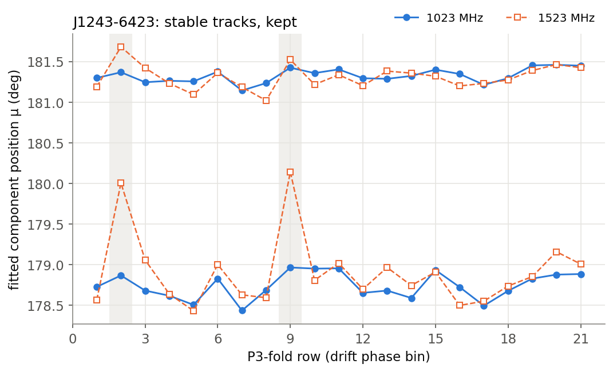

*Figure 2. J1243−6423, kept: two stable tracks in both bands, 8 bins apart. Shaded rows were removed
by the outlier gate.*

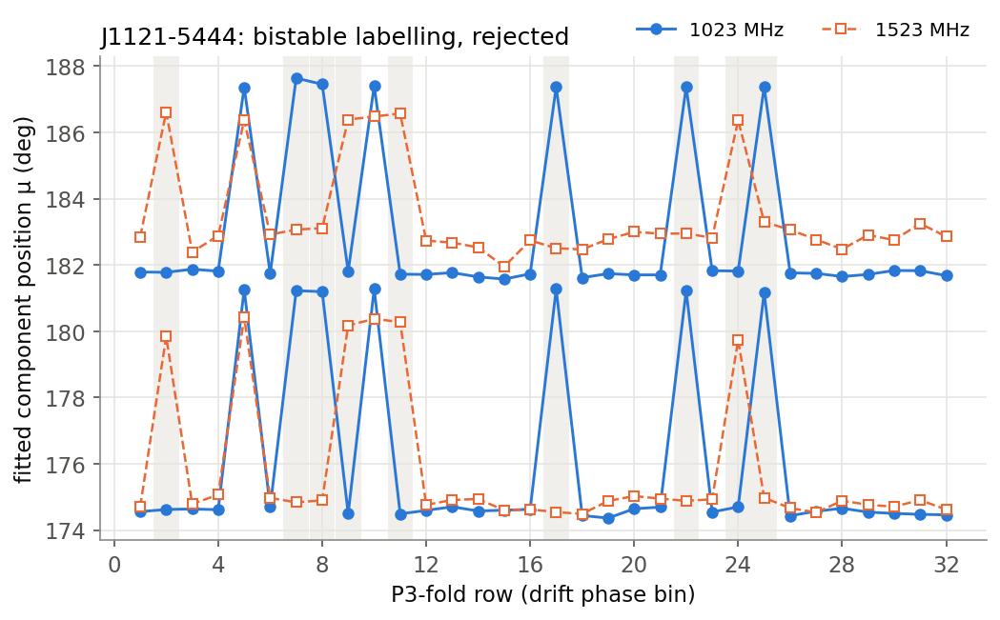

*Figure 3. J1121−5444, rejected: the sorted positions jump between two levels (26 jumps). Two
Gaussians sit alternately on different features, so a row-by-row offset is meaningless.*

**57 of the 102 passed pulsars were kept.** Main reasons for rejection: bistable labelling (Fig. 3),
a scattered high band next to a stable low band, converging or overlapping tracks (two Gaussians
on one component), and a persistent low/high offset in one component only.
(The 21 "merged components" cases were also reviewed and all rejected.)

### 3.5 Sample flow

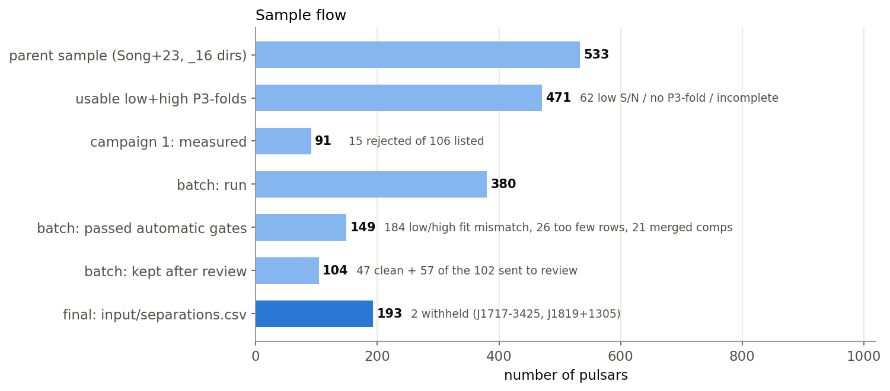

*Figure 4. From the parent sample to the final file. Campaign 1 (91) and the batch (380) are two
disjoint branches of the 471 pulsars with usable P3-folds.*

### 3.6 Withheld and flagged pulsars

- **J1717−3425** (ΔW/W = −0.742 ± 0.109) passed as "clean" because the |ΔW/W| > 0.4 gate was added
  after the run. Nobody has looked at it yet. **Withheld.**
- **J1819+1305**: the kept value W = 13.35° cannot be reproduced from the per-row fits for
  any pair of components (`maciej_separations.md` §4.1). **Withheld.**
- Both are still in `input/separations_merged.csv` (195 rows, with provenance column `zrodlo`),
  but not in `input/separations.csv` (193 rows).
- J1714−1054 and J2139+2242 carry quality marks < 6 in `offsets.csv` that describe **old** fits;
  `ppdot_separations` therefore drops them (Fig. 17 shows 191/193). Their current fits passed review
  (J1714−1054 χ² = 0.91; J2139+2242 kept in the manual review), so the marks need revising.
- An independent set of 50 separations (`input/separations_maciej.csv`) agrees within 3σ for 41/47
  common pulsars; in every resolvable disagreement our value is the one reproduced from the
  per-row fits. It is kept as reference only (`maciej_separations.md`).

---

## 4. Results

### 4.1 Narrowing is a population effect

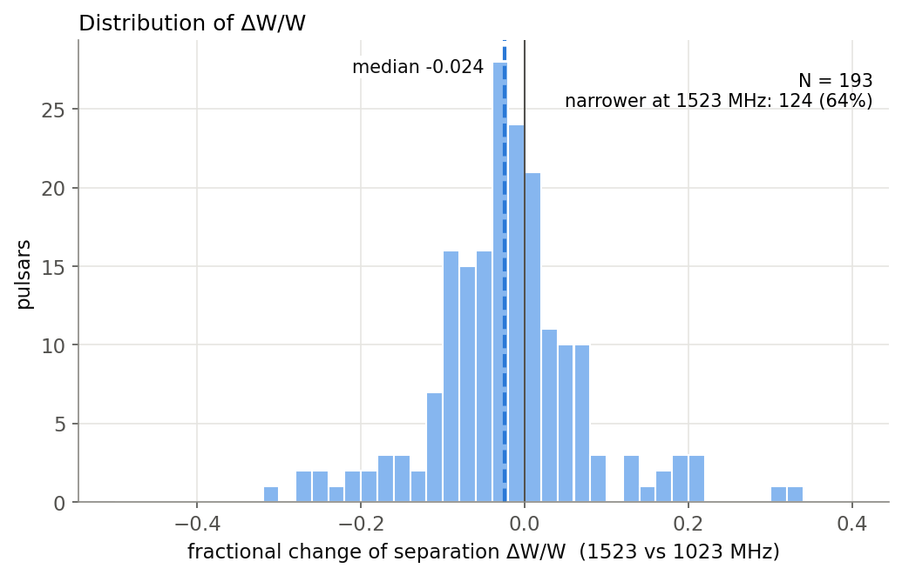

*Figure 6. ΔW/W for the 193 pulsars.*

| quantity | value |
|---|---|
| N | 193 |
| median ΔW/W | −0.0243, 68% CI [−0.0276, −0.0163] |
| narrower at 1523 MHz | 124 (64%), binomial p = 9.2×10⁻⁵ |
| beyond 3σ | 59 narrower, 22 wider |
| scatter | SD 0.095, robust (1.48·MAD) 0.071 |
| median error | 0.021 |

The effect is weak. The spread between pulsars is 3–4× larger than the measurement errors, so
a real fraction of pulsars **widen** with frequency.

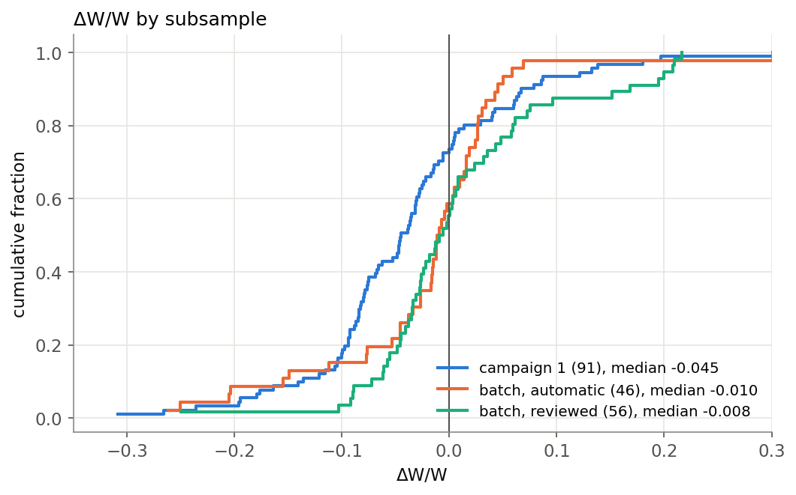

*Figure 7. Cumulative distributions for the three subsamples.*

| subsample | N | median ΔW/W | narrower |
|---|---|---|---|
| campaign 1 | 91 | −0.045 | 73% |
| batch, automatic | 46 | −0.010 | 59% |
| batch, reviewed | 56 | −0.008 | 55% |

The batch pulsars narrow **less** (KS campaign 1 vs batch: p = 4×10⁻⁴). The most likely cause:
the campaign-1 list was itself selected from cases where an offset was measurable and
significant, i.e. biased towards large |ΔW/W|. The unselected batch is probably closer to the
population.

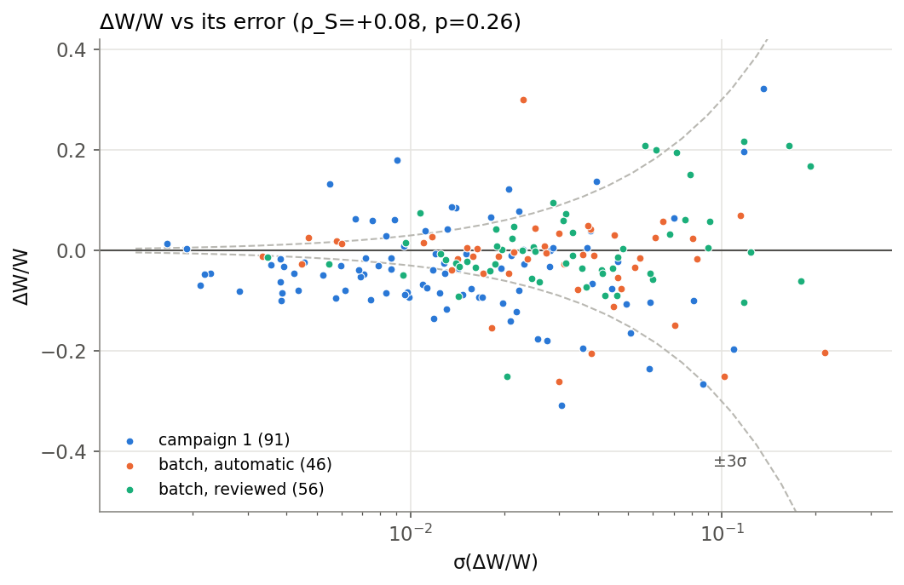

*Figure 16. ΔW/W against its error; dashed lines: ±3σ.*

There is no significant trend of ΔW/W with its error (ρ_S = +0.08, p = 0.26), so the result
is not driven by the noisiest measurements. Splitting at the median error, however, the more
precise half has median −0.030 and 71% narrowing, while the noisier half has −0.0095 and 57%.
This is what measurement noise does to a sign statistic: it dilutes it towards 50%. **The
true narrowing fraction is therefore probably higher than 64%.** The difference is partly the
same thing as Fig. 7, because campaign-1 pulsars are the most precise.

### 4.2 Normalisation: the absolute change scales with width

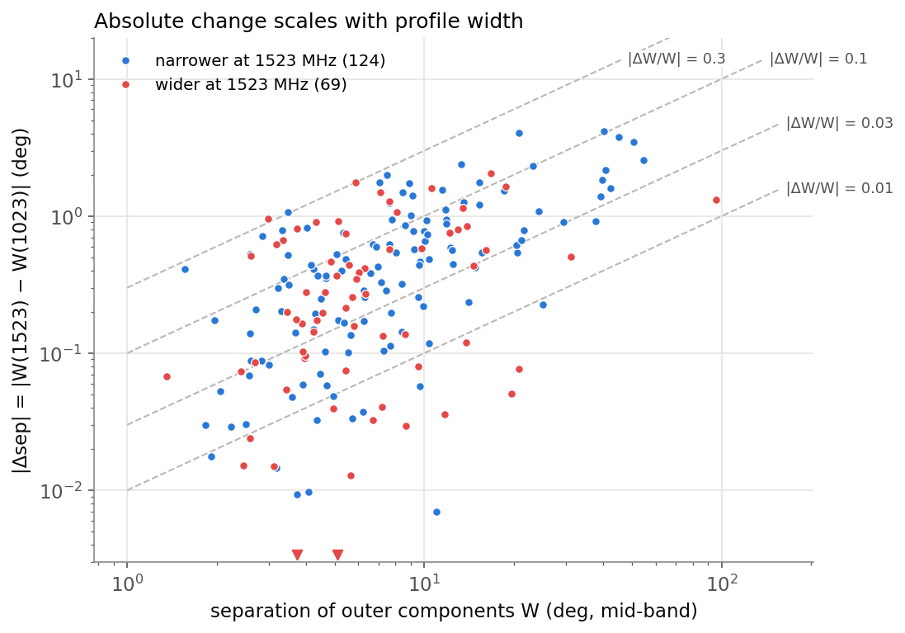

*Figure 9. |Δsep| against W; dashed lines are constant |ΔW/W|. Two pulsars with |Δsep| < 0.003°
are drawn at the bottom edge.*

|Δsep| correlates strongly with W (ρ_S = +0.56, p = 4×10⁻¹⁷), while |ΔW/W| does not
(ρ_S = +0.01, p = 0.86). Dividing by W removes the width dependence completely, so ΔW/W is the
right quantity.

### 4.3 Both edges move inwards: not a DM error

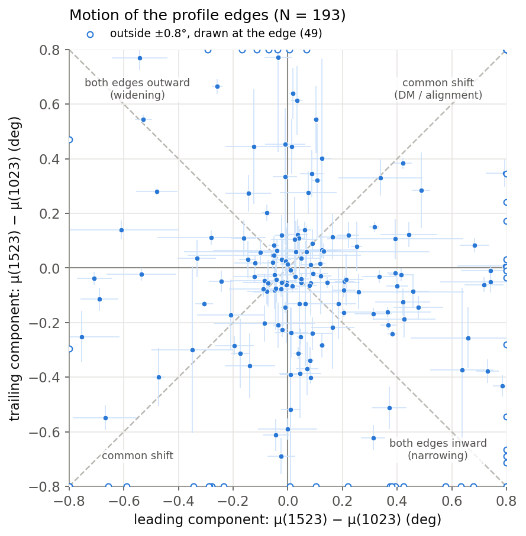

*Figure 10. Offset of the leading against the trailing component. A DM or alignment error moves
both edges the same way (diagonal). Narrowing puts a pulsar in the lower right. Points outside
±0.8° are drawn as open circles on the frame.*

| edge | median offset | sign | Wilcoxon p |
|---|---|---|---|
| leading component | +0.044° | 114/193 positive (moves later) | 3.7×10⁻⁴ |
| trailing component | −0.048° | 116/193 negative (moves earlier) | 8.0×10⁻³ |
| centroid (common shift) | +0.012° | 104/193 | 0.22 |

The two edges move towards the centre independently and by the same amount (Wilcoxon on
|lead| − |trail|: p = 0.73), and their offsets are uncorrelated (ρ_S = +0.03). The common shift
is consistent with zero. A residual DM or misalignment would put the points along the diagonal;
they are not there. Quadrants: 69 both inwards, 32 both outwards, 92 with the same sign
(the scatter of individual edges is large, so the median tendency matters, not the count
per quadrant).

### 4.4 Spectral index of the separation

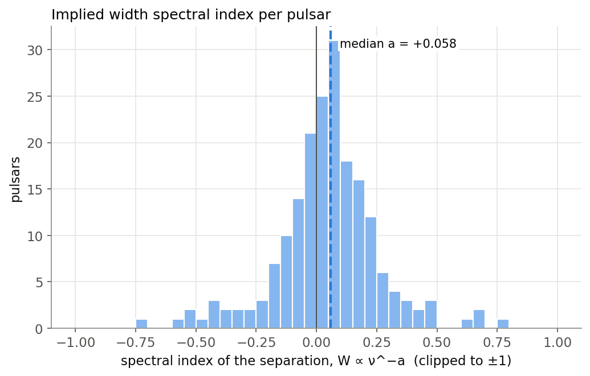

*Figure 8. a from W(1523)/W(1023) = ((1 + f/2)/(1 − f/2)) = (ν_high/ν_low)^−a, with f = ΔW/W and
each pulsar's own band centres.*

Median **a = +0.058**, 68% CI [+0.036, +0.063]; a > 0 for 124/193. This is a weak frequency
dependence. The natural reference is the Thorsett (1991) relation for exactly this quantity, the
separation of the outermost components, Δθ = A ν^−α + Δθ_min: above ~1 GHz many pulsars approach
the constant term, so a small local index is expected. Two caveats: W here is the separation of
fitted Gaussians, not of peaks, and the lever arm is only a factor ~1.5 in frequency.
A like-for-like comparison with multi-frequency fits (e.g. Chen & Wang 2014) has not been made.

### 4.5 Dependence on pulsar parameters

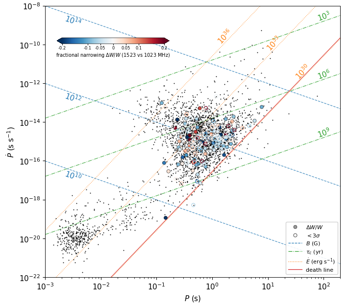

*Figure 17. P–Ṗ diagram coloured by ΔW/W (`Plot.ppdot_separations`, linear scale ±0.2; open
symbols: < 3σ). 191 of 193 shown (§3.6).*

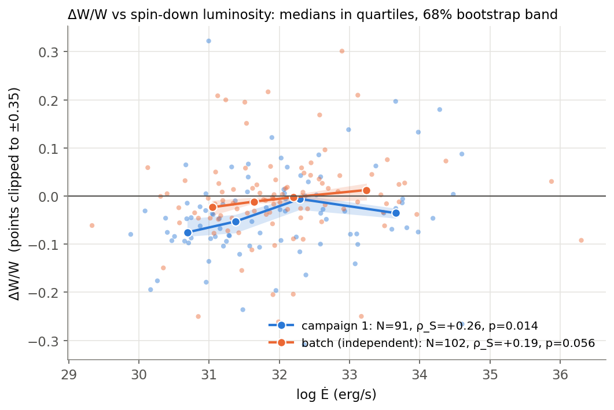

*Figure 11. ΔW/W against Ė for campaign 1 and the batch separately; medians in Ė quartiles with
68% bootstrap bands.*

The only parameter showing a signal is Ė (equivalently τ_c or Ṗ, which are collinear here).
P and B do not. Weights 1/σ² are useless because the scatter is intrinsic (§4.1), so Spearman
ranks are used.

| sample | N | ρ_S | p |
|---|---|---|---|
| campaign 1 (where the hypothesis came from) | 91 | +0.257 | 0.014 |
| **batch (independent)** | **102** | **+0.190** | **0.056** |
| all | 193 | +0.223 | 0.0018 |

**The trend is not confirmed on the independent sample**, though it is not ruled out either.
The batch value is fragile: with the two withheld pulsars included (N = 103) it was ρ_S = +0.158,
p = 0.11. The pooled p = 0.0018 is dominated by the sample that suggested the hypothesis, so it is
not an independent confirmation. If real, the effect is modest: the median ΔW/W differs by
3 percentage points between the lowest and highest Ė quartiles (−0.046 vs −0.014), a third to a
half of the population scatter.

### 4.6 Exploratory tests (new, not pre-registered)

The four tests in this section were made for this document. **Treat them as leads, not results.**
With four looks, a nominal p ≈ 0.01 is needed for 5% family-wise significance.

#### Drifters vs P3-only

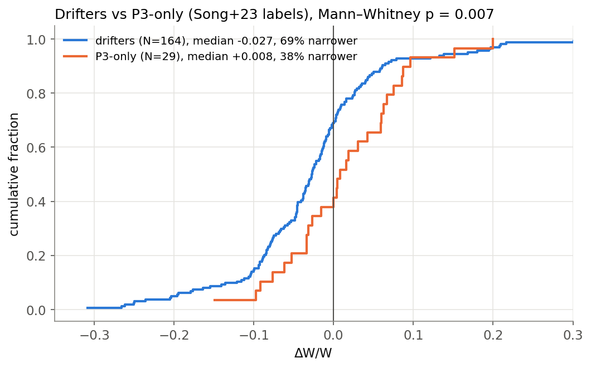

*Figure 12. ΔW/W of pulsars that Song+23 label as drifting vs P3-only (amplitude modulation without
measurable drift).*

| | N | median ΔW/W | narrower |
|---|---|---|---|
| drifters | 164 | −0.027 | 69% |
| P3-only | 29 | +0.008 | 38% |

Mann–Whitney p = 0.007 (survives the ×4 correction: 0.03). However:

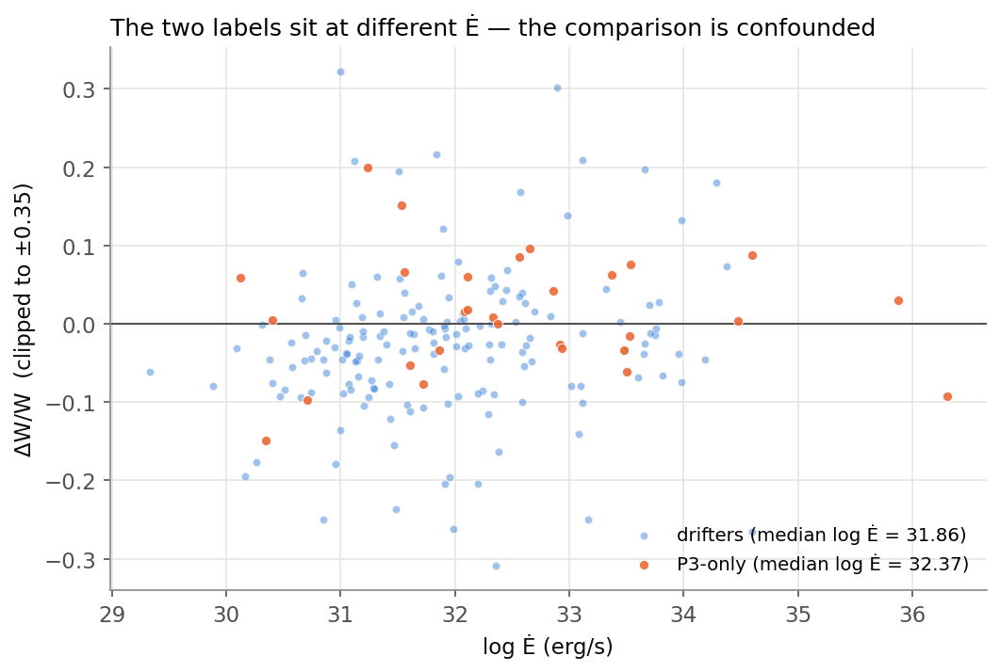

*Figure 13. The same split against Ė.*

P3-only pulsars have higher Ė (median log Ė 32.37 vs 31.86, MW p = 0.019), consistent with drifting
being concentrated at low Ė (Song et al. 2023), and higher Ė goes with weaker narrowing (§4.5). The two
explanations are therefore entangled. With Ė and campaign controlled (permutation of the
labels within Ė-tercile × campaign strata), the difference in medians (+0.035) has **p = 0.052**.
In a rank regression on label, Ė and campaign, t = −2.1 for the label. By subsample: campaign 1
p = 0.027 (80 vs 11), batch p = 0.20 (84 vs 18). **It is a hint that narrowing is tied to
drifting rather than to Ė, or vice versa, and these data cannot separate the two.** More P3-only
pulsars are needed: the parent sample has 115, of which only 29 are measured.

#### ΔW/W vs P3

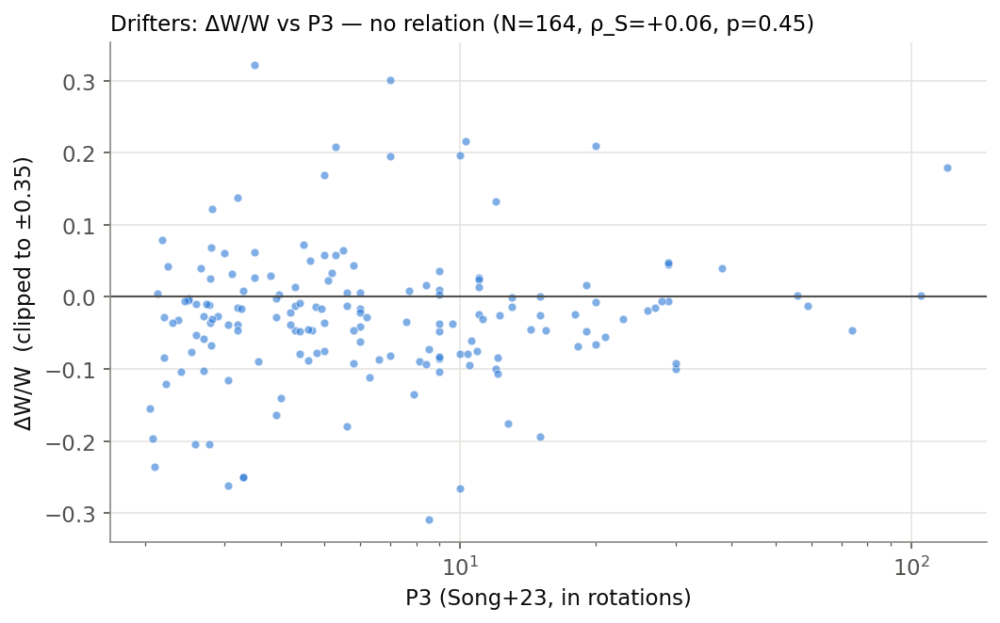

*Figure 14. Drifters only, P3 from Song+23.*

No relation (ρ_S = +0.06, p = 0.45, N = 164). The carousel modulation period does not predict
how the profile narrows. (P3 values may be aliased; this does not affect a null result much.)

#### Separation vs period

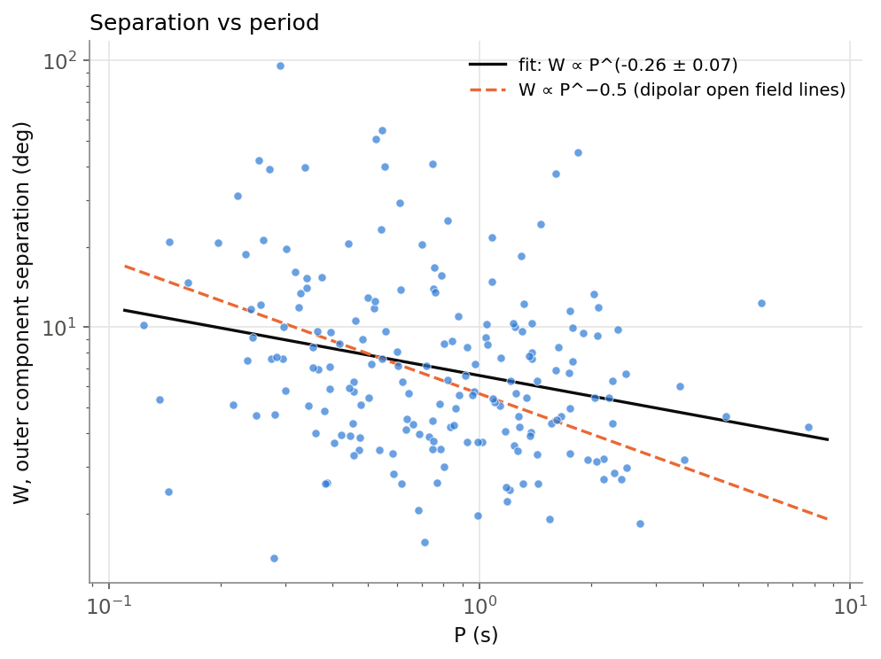

*Figure 15. W against P with a power-law fit; the dashed line is the P^−1/2 scaling of the
open-field-line region, normalised at the median.*

W ∝ P^(−0.26 ± 0.07) (ρ_S = −0.25, p = 3.5×10⁻⁴). The separations behave like a beam-width quantity
and shrink with period, but more weakly than P^−1/2. That is expected without correcting
for the viewing geometry (α, β) and for the fact that two outer Gaussians are not a fixed fraction
of the open-field region. It is a sanity check that the measured W is physical, not a test of the
beam model.

#### Selection by precision

Fig. 16, discussed in §4.1.

---

## 5. Limitations and open issues

1. **The 184 "fit mismatch" pulsars (§3.3)** are the biggest opportunity. Their data are aligned;
   only the fit fails. Recovering ~100 of them would bring N to ~300 and settle the Ė question
   (power ~99% for ρ = 0.25).
2. **Geometry.** The scatter is intrinsic and not explained by P or Ṗ; the obvious candidate is
   α and β. Not tested (it needs RVM fits from the literature).
3. **Selection of the parent sample.** All pulsars show drift or P3 modulation, so the conclusions
   apply to that population.
4. **Only the outer components** enter Δsep, so the inner structure of 3- and 4-component profiles
   is not used. `n_comp = 2` for genuinely 3-component pulsars is not neutral.
5. **Withheld:** J1717−3425 and J1819+1305 (§3.6) need to be checked by eye and either added or rejected.
6. **Quality marks in `offsets.csv`** describe old fits; J1714−1054 and J2139+2242 drop out of the
   P–Ṗ figure because of them.
7. **Campaign 1 is a selected subsample** (§4.1); pooled statistics mix two different selections.
8. The drifter vs P3-only difference (§4.6) needs a larger P3-only sample before it can be called
   a result.

---

## 6. Files and reproduction

| what | where |
|---|---|
| result, canonical (193) | `input/separations.csv` |
| result with provenance, band centres, ΔW/W (195, incl. 2 withheld) | `input/separations_merged.csv` |
| campaign-1 input list | `input/separations_todo.csv` |
| independent reference | `input/separations_maciej.csv` |
| batch raw output (149) and status | `~/claude/work/separations_batch_full.csv`, `logs/batch_full.log` (`RESULT:` lines) |
| review verdicts | `~/claude/work/review_verdicts.csv` |
| table used for this document | `~/claude/work/offsets_doc/table.csv` (+ `batch_status.csv`, `misalign.csv`) |
| figures | `docs/figures/offsets_*.png` |
| chronological log | `docs/separations_analysis_log.md` |

Scripts (in `~/claude/work/scripts/`, outside the repository):

```bash
python3 offsets_doc_data.py      # table.csv: separations.csv + logs (edge offsets) + psrcat + Song+23 labels
python3 offsets_doc_misalign.py  # misalign.csv: whole-profile low/high shift for the batch (Fig. 5)
python3 offsets_doc_figs.py      # figures 1–16 + all statistics quoted here (stdout)
psrx julia --project=/home/psr/software/spats /home/psr/work/scripts/check_sep_merge.jl   # Fig. 17
```

The edge offsets (Fig. 10) come from the `Weighted mean offsets` blocks of the run logs. A block is
assigned to a pulsar only if its `separation` and `Δ separation` match the CSV row to 10⁻⁴ deg,
which holds for 193/193. Check: trailing − leading offset equals `dsep` for all rows.

Code in the repository: `Plot.analyse_p3folds4_agent` (kwarg `plots`), `Plot._offset_summary`
(writes `dsep`), `Plot._read_separations`, `Plot.ppdot_separations`, `Plot._ppdot` (linear colour
scale).

## References

- Hassall T. E. et al. 2012, A&A 543, A66: frequency evolution of profile components, LOFAR.
- Chen J. L., Wang H. G. 2014, ApJS 215, 11: frequency dependence of pulse width for 150 normal pulsars.
- Song X. et al. 2023, MNRAS 520, 4562: The Thousand-Pulsar-Array programme on MeerKAT – VIII. The subpulse
  modulation of 1198 pulsars (sample, P3, drift / P3-only labels).
- Thorsett S. E. 1991, ApJ 377, 263: Frequency dependence of pulsar integrated profiles.
