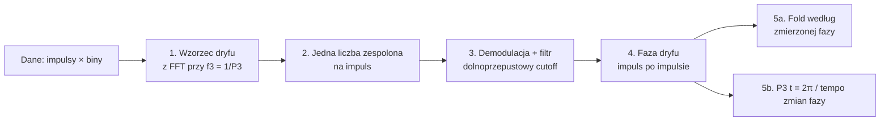
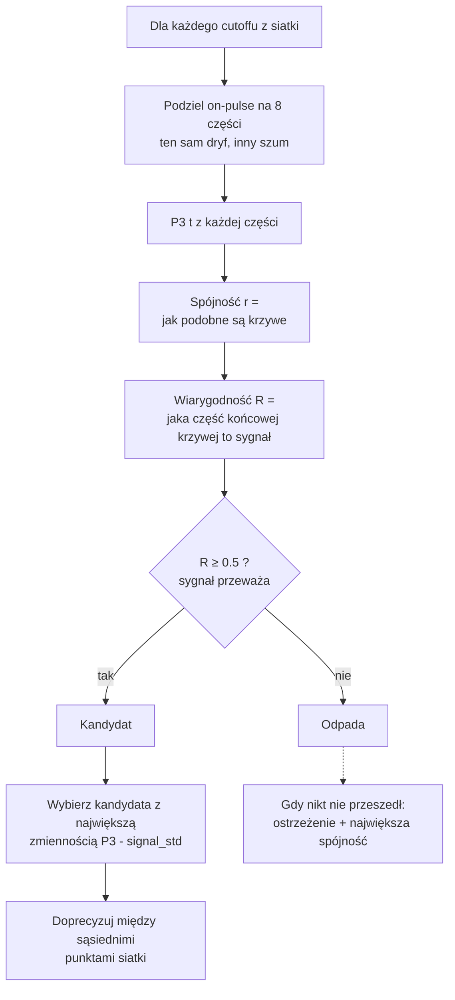

# Coherent P3-fold — problemy, zmiany i wyniki

> Podsumowanie prac nad śledzeniem zmian P3 w czasie (`p3fold_coherent`, `p3fold_cutoff_scan`).
> Pliki: `spats.jl`, `modules/p3fold_viterbi.jl`, `modules/plot.jl`.

---

## W skrócie

| # | Temat | Status | Najważniejszy efekt |
|---|---|:---:|---|
| 1 | Dlaczego wyniki różnią się między cutoffami + jak wykluczyć pokrywające się | ✅ | wyjaśnione + mapa cutoff × impuls + usuwanie duplikatów |
| 2 | Uzależnić siatkę 20 cutoffów od P3 | ✅ | każdy pulsar ma własny, sensowny zakres |
| 3 | Niespójność linii odniesienia na wykresach | ✅ | jedna, opisana linia nominalnego P3 na każdym wykresie |
| 4 | Stary czy nowy `bin_search` | ✅ | zostaje nowy — SNR J1750: **2.1 → 3.0** |
| 5 | Zmienność P3 — szerszy temat | ⏸ | wstępne przemyślenia + plan (bez kodu) |
| 6 | J2053 na starym kodzie — skąd szachownica | ✅ | nie z tej sesji; na starym kodzie z dobrym cutoffem fold jest dobry |
| + | Fałszywy pik J1750 przy ~630 | ✅ | pik zniknął, odrzucone cutoffy: **6 → 0** |
| + | Automatyczny wybór cutoffu | ✅ | koniec z wybieraniem najbardziej zaszumionego |

---

## Jak działa metoda (w 5 krokach)



Po ludzku: zamiast zakładać, że P3 jest stałe, mierzymy **fazę dryfu w każdym impulsie**.
Fold układamy według tej fazy (dlatego jest ostrzejszy niż fold ze stałym P3), a z tego,
jak szybko faza rośnie, liczymy **P3 w funkcji czasu**.

**Cutoff** to jedyny ważny parametr: mówi, jak szybkie zmiany P3 przepuszczamy.
`1/cutoff` = skala w impulsach (np. cutoff 0.01 → zmiany wolniejsze niż ~100 impulsów).

---

## Zadanie 1 — dlaczego wyniki różnią się między cutoffami + jak wykluczyć pokrywające się

**Odpowiedź:** to normalne działanie filtra, nie błąd.

| Cutoff | Co widać | Ryzyko |
|---|---|---|
| **niski** | gładka krzywa | gubi szybkie zmiany, zaniża ich wielkość, może je nawet **odwrócić** |
| **wysoki** | dużo szczegółów | dużo szumu |

Konkretne przykłady z danych:

- **J1750:** rozrzut P3 = **2.6** przy cutoff 0.002, a **9.2** przy 0.010 — ten sam pulsar, inny filtr.
- **J1539, impuls ~550:** przy niskim cutoffie *pik*, przy wysokim *dołek*.
  Prawdziwy jest dołek — widać go we wszystkich niezależnych częściach danych.
  Niski filtr jest po prostu za wolny, żeby za tą szybką zmianą nadążyć.

**Co zrobiono:** mapa *cutoff × impuls* (`Plot.p3_cutoff_heatmap`):

```
cutoff ▲
 wysoki │   ██        ▓▓                ██ ← pionowy pas przez wiele
        │   ██        ▓▓                ██   cutoffów = PRAWDZIWA zmiana
        │   ██        ▓▓      ░░        ██
  niski │   ██        ▓▓                ██   ░░ tylko w jednym wierszu
        └─────────────────────────────────▶ = ARTEFAKT filtra
                                      impuls
```

**Wykluczanie pokrywających się cutoffów** (`dedupe_redundant_cutoffs`):
jeśli krzywa P3(t) dla danego cutoffu prawie nie różni się od poprzedniej
(średnia różnica < 5% rozrzutu krzywej), jest pomijana na wykresie krzywych.

- Kiedyś było to potrzebne: stara siatka sięgała bardzo niskich cutoffów, które dawały kilka identycznych płaskich linii.
- Teraz, po zadaniu 2, siatka jest dopasowana do P3 i krzywe są różne — w testach J1750 i J1539 nic nie zostało usunięte.
  Mechanizm zostaje jako zabezpieczenie.

**Wniosek:** cutoff trzeba dobrać dla każdego pulsara osobno → automatyczny wybór (niżej).

---

## Zadanie 2 — zakres cutoffów zależny od P3

**Problem:** wcześniej jedna stała siatka dla wszystkich pulsarów.
Dla długiego P3 (J1750) część cutoffów była szybsza niż sam cykl dryfu (bez sensu),
a dla krótkiego P3 (J2053) siatka kończyła się za wcześnie.

**Co zrobiono:** granice wynikają z fizyki:

| Granica | Wzór | Dlaczego |
|---|---|---|
| najszybsza skala | **2 · P3** impulsów | żeby zobaczyć zmianę P3, trzeba widzieć ≥ 2 cykle dryfu |
| najwolniejsza skala | **N / 3** impulsów | wolniejsza zmiana wygląda już jak stałe P3 |
| między nimi | 20 punktów, skala log | |

**Wynik (sprawdzone ręcznie z wydrukiem):**

| Pulsar | P3 | Zakres cutoffów |
|---|---:|---|
| J1750-3503 | 49 | 0.0020 – 0.0102 |
| J1539-6322 | 12.7 | 0.0027 – 0.0394 |
| J1110-5637 | 8.6 | 0.0029 – 0.0583 |
| J2053-7200 | 3.0 | 0.0029 – 0.166 |

---

## Zadanie 3 — niespójność linii odniesienia na wykresach

**Problem:** na wykresie P3(t) dla J1750 była pozioma linia odniesienia (ok. P3 ≈ 30),
a dla innych pulsarów nie było żadnej. Nie było wiadomo, co ta linia oznacza ani dlaczego czasem jej brak.

**Co zrobiono:** jedna, zawsze ta sama linia odniesienia = **nominalne P3** (wartość z `params.json`),
z podpisem w legendzie (np. „nominalne P3 = 49”). Jest na każdym wykresie P3(t), dla każdego pulsara.
Na mapie cutoff × impuls ta sama wartość to kolor biały.

**Sprawdzone:** linia była obecna i poprawna we wszystkich testach (49 / 12.69 / 8.577 / 3.013).

Przy okazji dodano wykresy diagnostyczne:

| Wykres | Co pokazuje | Jak czytać |
|---|---|---|
| `lowpass_cutoff_scan` | spójność, rozrzut P3, signal_std vs cutoff | ⭐ = wybrany cutoff, kropkowana linia = próg wiarygodności |
| `p3_tracks_vs_cutoff` | krzywe P3(t) dla wszystkich cutoffów | kropkowana linia = nominalne P3 |
| `p3_cutoff_heatmap` | mapa cutoff × impuls | pionowy pas = prawdziwe, plama = artefakt |
| `p3fold_compare` | fold koherentny vs stałe P3 + P3(t) z paskiem błędu | szary pas = niepewność |
| `subband_consistency` | P3(t) z 4 niezależnych części danych | pik w większości linii = prawdziwy |

Przykład odczytu (J1750): pik przy **~880** jest we wszystkich częściach → prawdziwy;
pik przy **~700** jest wyraźny tylko w jednej → niepewny.

---

## Zadanie 4 — stary czy nowy `bin_search`

**Problem:** częstość dryfu prawie nigdy nie trafia dokładnie w bin FFT — wypada *między* binami,
więc wzorzec zbudowany z jednego binu jest słabszy.

```
moc │        ┃
    │     ┃  ┃  ┃          bin z P3 nie zawsze jest najsilniejszy
    │  ┃  ┃  ┃  ┃  ┃       → sprawdzamy ±2 biny i bierzemy najmocniejszy
    └──────────────────▶ częstość
          k-2 … k+2
```

**Co zrobiono:** `bin_search = 2` — wybór binu z największą mocą w on-pulse.

**Wynik (J1750, te same pozostałe ustawienia):**

| | SNR | Ostrzeżenie o słabym sygnale |
|---|---:|:---:|
| przed (`bin_search = 0`) | 2.1 | tak |
| po (`bin_search = 2`) | **3.0** | nie |

**Decyzja:** zostaje nowy (`bin_search = 2`) jako domyślny. Test był porównawczy:
ten sam pulsar, ten sam cutoff (1/300) i to samo `ybins`, zmienione tylko `bin_search`.

---

## Zadanie 5 — znaczenie zmienności P3

**Pytanie:** ile ze zmian P3 to prawdziwe zachowanie pulsara, a ile szum — i jak to porównać między pulsarami.

**Status:** bez kodu — wstępne przemyślenia i plan. Wcześniej sam pomiar P3(t) był niepewny
(fałszywe piki, zły wybór cutoffu); teraz program podaje, **jaka część krzywej to sygnał (R)**, więc jest na czym to badać.

**Fizyczne znaczenie:** w modelu karuzeli zmiana P3 = zmiana prędkości obrotu iskier,
czyli zmiana warunków (pola elektrycznego) w szczelinie nad powierzchnią gwiazdy.

**Trzy pułapki przy interpretacji:**

1. **Porównywać w częstości, nie w P3.** P3 = 1/częstość, więc przy dużym P3 mała zmiana wygląda ogromnie.
   Szybki rachunek z ostatniego testu (zmienność sygnału przeliczona na częstość):

   | Pulsar | P3 | Zmienność w P3 | W częstości (cykle/impuls) | Względnie |
   |---|---:|---:|---:|---:|
   | J1750 | 49 | ±5.4 | ±0.0022 | 11% |
   | J1539 | 12.7 | ±0.27 | ±0.0017 | 2% |
   | J1110 | 8.6 | ±0.32 | ±0.0043 | 4% |
   | J2053 | 3.0 | ±0.019 | ±0.0021 | 0.6% |

   W częstości wszystkie są podobne — to może być fizyka, ale też **dolna granica samej metody**.
2. **Aliasing.** Widzimy P3 obserwowane; jeśli pulsar jest zaliasowany, ta sama zmiana oznacza zupełnie inną zmianę prędkości karuzeli.
   Kształt zmian (kiedy rośnie / spada, skoki) jest wiarygodny niezależnie od tego.
3. **Różne cutoffy.** Wyższy cutoff zawsze daje większą zmienność → do porównań trzeba liczyć zmienność na **tej samej skali czasu** dla wszystkich.

**Co zmienność może oznaczać:**

| Obserwacja | Możliwe znaczenie |
|---|---|
| P3 stabilne (tylko szum) | stabilna karuzela, „czysty” dryf |
| powolne, płynne wędrowanie | ciągłe zmiany warunków w szczelinie |
| nagłe skoki między poziomami | zmiany modów dryfu |
| zmiana P3 po nullach / spadkach intensywności | związek dryfu z emisją |
| duża, nieregularna zmienność | raczej modulacja amplitudy niż dryf → cecha dla klasyfikatora |

**Plan:**
1. **Test szumu:** sztuczne dane ze *stałym* P3 i tym samym SNR → ile zmienności daje sama metoda. Prawdziwa zmienność = nadwyżka ponad to.
2. **Miary dla każdego pulsara:** zmienność w częstości na wspólnych skalach czasu, skala czasu zmian, płynne vs skokowe, korelacja z intensywnością.
3. **Porównanie wielu pulsarów:** względem Ė i na diagramie P–Pdot, osobno dryf i modulacja amplitudy.

---

## Zadanie 6 — J2053 na starym kodzie: skąd szachownica

**Pytanie:** fold J2053 wyglądał jak szachownica. Czy to wina zmian z tej sesji
(`bin_search`, `p3_window`), czy było tak też na starym kodzie?

**Test:** stary kod w całości — `bin_search = 0`, `p3_window = 20`, stare `ybins = 10` —
ale z **dobrym cutoffem** (0.027, wybranym przez skan).

**Wynik:** fold wyglądał dobrze, wyraźnie lepiej niż wcześniej.

**Wniosek:**
- szachownica **nie** pochodziła ze zmian z tej sesji (`bin_search`, `p3_window`);
- skoro nawet ze starym `ybins = 10` fold był dobry, główną przyczyną był **źle dobrany cutoff**, a nie same biny.

**Co zrobiono dodatkowo (zabezpieczenie):** `ybins = 10` przy P3 ≈ 3 to i tak za dużo
(na cykl dryfu przypadają ~3 impulsy, więc część binów jest prawie pusta). Liczba binów
jest teraz liczona automatycznie (`find_ybins`):

```
ybins = max(4, floor(2 · P3))      ograniczone tak, by na bin było ≥ 50 impulsów
J2053: 2 · 3.01 → 6 binów
```

Działa we **wszystkich** foldach (`p3fold_coherent`, `p3fold_coherent_auto`, skan, `p3fold_refine`, `p3fold_norefine_compare`).

---

## Dodatkowo: fałszywy pik w J1750 przy ~630

**Objaw:** ostry pik P3 do ~91 (lub dołek do ~32 przy sąsiednim cutoffie) — nie było go w starej analizie.

**Przyczyna:** w tym miejscu sygnał dryfu na chwilę prawie znika. Po filtrze sygnał zespolony
przechodzi blisko zera i jego faza obraca się o **pół obrotu** w kilka impulsów.
Stara metoda dopasowywała prostą do fazy i brała ten obrót za zmianę P3.

```
        Im                                faza
         │   ╭──╮                          │        ┌──────  skok o π
         │  ╱    ╲                         │        │        (stara metoda: "zmiana P3")
  ───────┼─●──────╲───── Re                │────────┘
         │         ╲  sygnał mija zero     └──────────────▶ impuls
         │          ╰── po jednej          kierunek skoku zależy od tego,
                        albo drugiej       z której strony minie zero
                        stronie            → czerwone / niebieskie plamy obok siebie
```

**Co zrobiono:** tempo zmian fazy liczone estymatorem *pulse-pair* (`phase_rate`):
każda zmiana fazy ważona siłą sygnału w dwóch sąsiednich impulsach.
Gdy sygnał prawie znika, jego waga jest prawie zerowa → obrót nie wpływa na wynik.

**Wynik:**

| Test | Stara metoda | Nowa metoda |
|---|---|---|
| dane syntetyczne (prawdziwe P3 = 49) | 33 lub 96 | 47 – 51 |
| śledzenie prawdziwej zmiany P3 | — | błąd ~0.2 |
| J1750: pik przy ~630 | jest | **zniknął** |
| J1750: odrzucone cutoffy | 6 z 20 | **0 z 20** |

---

## Dodatkowo: automatyczny wybór cutoffu

**Problem:** stary wybór zawsze uciekał na najwyższy cutoff (najbardziej zaszumiony) —
J1110 dostał 0.059, J2053 wyszedł nawet **poza** zakres (0.193).

**Jak działa teraz:**



**Zasada:** *jak najwięcej szczegółów, dopóki sygnał przeważa nad szumem.*

| Gdyby wybierać tylko po… | Wynik |
|---|---|
| największej spójności | prawie płaska krzywa — pewna, ale nic nie pokazuje |
| największym rozrzucie P3 | najbardziej zaszumiona krzywa |
| **obu naraz (nowe)** | szczegółowo, ale wiarygodnie |

Dodatkowo: jeśli przy jakimś cutoffie P3 gdzieś „wybucha” (> 3× nominalne), **cały** cutoff jest pomijany.

---

## Wyniki dla 4 pulsarów

| Pulsar | P3 | SNR | Wybrany cutoff | Skala | R | Wniosek |
|---|---:|---:|---:|---:|---:|---|
| **J1750-3503** | 49 | 3.0 | 0.0097 | ~100 imp. | 0.81 | 🟢 wyraźna zmienność P3 (40–70) |
| **J1539-6322** | 12.7 | 26.1 | 0.027 | ~37 imp. | 0.79 | 🟢 wyraźna zmienność, dołek do 11 przy ~550 |
| **J1110-5637** | 8.6 | 8.0 | 0.056 | ~18 imp. | 0.66 | 🟡 zmienność jest, ~1/3 to szum |
| **J2053-7200** | 3.0 | 3.5 | 0.025 | ~40 imp. | 0.50 | 🟠 na granicy szumu → P3 ≈ stałe |

Uzasadnienie wyborów:

- **J1750** — wszystkie cutoffy przechodzą próg; w wybranym miejscu jest jednocześnie największa zmienność **i** największa spójność → wybór pewny.
- **J1539** — niższe cutoffy mają wyższą spójność, ale gubią szczegóły i źle pokazują dołek przy ~550.
- **J1110** — warunek spełniony, ale spójność mocno skacze między sąsiednimi cutoffami → wybór mniej pewny (spokojniejsza alternatywa: 0.0064).
- **J2053** — próg przekroczony o włos (r = 0.113 przy progu 0.111), a spójność skacze o ±0.05 → wynik praktycznie losowy, traktować P3 jako stałe.

---

## Ograniczenia i dalsze kroki

| Ograniczenie | Skutek | Możliwa poprawka |
|---|---|---|
| początek / koniec obserwacji | pierwsze i ostatnie ~50 impulsów mniej pewne (np. J1750: P3 ≈ 95 na starcie) | oznaczać lub wycinać krawędzie |
| słaby sygnał (SNR ≈ 3) | wybór cutoffu niestabilny (J2053, J1110) | uśredniać spójność z sąsiednimi cutoffami przed progiem |
| zadanie 5 | — | porównać zmienność P3 między pulsarami → klasyfikator dryf vs modulacja, diagram P–Pdot |

---

## Gdzie to jest w kodzie

| Funkcja | Plik | Rola |
|---|---|---|
| `coherent_fold` | `modules/p3fold_viterbi.jl` | główna metoda (fold + P3(t)) |
| `phase_rate` | `modules/p3fold_viterbi.jl` | tempo fazy odporne na zanik sygnału (**nowe**) |
| `cutoff_metrics` | `modules/p3fold_viterbi.jl` | spójność, signal_std, wiarygodność R |
| `refine_cutoff` | `modules/p3fold_viterbi.jl` | doprecyzowanie cutoffu (złoty podział) |
| `p3fold_cutoff_scan` | `spats.jl` | skan + automatyczny wybór cutoffu |
| `p3fold_coherent` | `spats.jl` | końcowy fold z wybranym cutoffem |
| `find_ybins` | `modules/functions.jl` | automatyczna liczba binów fazy |
