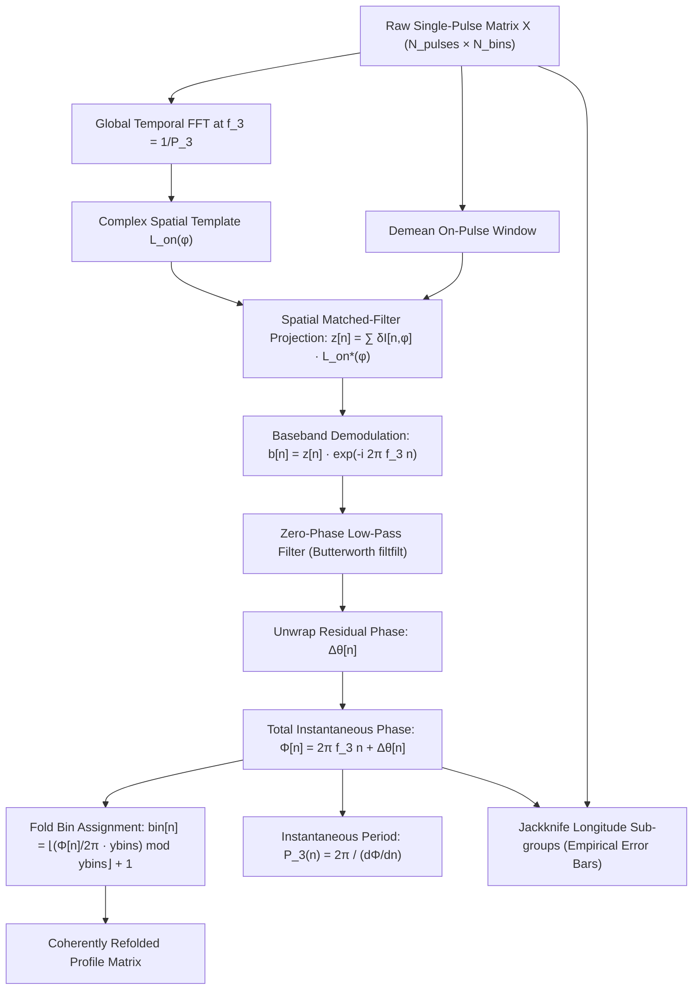

# Coherent $P_3$ Folding (`p3fold_coherent`): Methodology, Comparison, and Advantages

## 1. Executive Summary

In pulsar single-pulse analysis, **$P_3$ folding** is the standard technique used to detect and characterize subpulse drifting by phase-folding single-pulse intensity matrices over the subpulse modulation period ($P_3$). 

The `p3fold_coherent` function (implemented in [`spats.jl`](spats.jl#L345) and powered by [`modules/p3fold_viterbi.jl`](modules/p3fold_viterbi.jl#L298)) provides a **spatially matched-filtered, carrier-demodulated coherent fold**. Unlike standard (static) folding or greedy block-by-block refinement algorithms (such as PSRSALSA's `pfold`), `p3fold_coherent` continuously tracks the instantaneous phase and period of subpulse modulation on a pulse-by-pulse basis, preventing phase smearing and maximizing the signal-to-noise ratio (SNR) of folded subpulse drift bands.

---

## 2. Mathematical & Algorithmic Architecture

The coherent folding pipeline executes seven main mathematical stages:



### Step 1: Global Spatial Template Extraction
The function first runs an un-chunked, full-observation FFT along the pulse axis (time dimension) at the nominal modulation frequency $f_3 = 1 / P_3$:
$$F(f, \phi) = \sum_{n=1}^N X(n, \phi) \, e^{-i 2\pi f n}$$
Evaluating $F$ at the frequency bin $k \approx N / P_3$ yields the complex spatial emission profile:
$$L_{\text{on}}(\phi) = F(f_3, \phi) \quad \text{for } \phi \in [\text{bin\_st}, \text{bin\_end}]$$
Because this uses a single, full-length Fourier transform, it only requires phase coherence within one frequency resolution bin ($\Delta f = 1/N$), rendering it robust against moderate drift wobble.

### Step 2: Spatial Matched-Filter Projection
To track phase when individual pulses are faint, the static mean profile is removed ($\delta I(n, \phi) = X(n, \phi) - \langle X(\cdot, \phi) \rangle$), and each pulse is projected onto the complex conjugate template $w(\phi) = L_{\text{on}}^*(\phi)$:
$$z[n] = \sum_{\phi} \delta I(n, \phi) \, L_{\text{on}}^*(\phi)$$
This collapses all on-pulse longitude bins into a **single complex scalar per pulse** with optimal SNR weighting.

### Step 3: Baseband Carrier Demodulation
The scalar series $z[n]$ oscillates at the carrier frequency $f_3$. Multiplying by the conjugate carrier shifts the signal to complex baseband (DC):
$$b[n] = z[n] \, e^{-i 2\pi f_3 n}$$
If subpulse drifting is perfectly constant ($P_3(n) \equiv P_3$), $b[n]$ has a constant complex phase. Any phase drift, wobble, or mode shift manifests as a slow trajectory in the complex plane.

### Step 4: Zero-Phase Low-Pass Filtering
To suppress pulse-to-pulse noise, shot noise, and nulling artifacts without introducing temporal phase delays, $b[n]$ is filtered using a forward-backward Butterworth filter (`DSP.filtfilt`):
$$b_{\text{smooth}}[n] = \text{filtfilt}(b[n]; f_{\text{cutoff}})$$
The cutoff frequency (default $1/200$ to $1/300$ cycles/pulse) dictates the maximum drift rate variability that can be tracked.

### Step 5: Phase Reconstruction and Fold Assignment
The residual phase is extracted and unwrapped:
$$\Delta\theta[n] = \text{unwrap}(\arg(b_{\text{smooth}}[n]))$$
The total unwrapped $P_3$ phase of pulse $n$ is reconstructed as:
$$\Phi[n] = 2\pi f_3 n + \Delta\theta[n]$$
Each pulse $n$ is assigned to a discrete phase bin $j \in \{1, \dots, y_{\text{bins}}\}$:
$$j[n] = \left\lfloor \left( \frac{\Phi[n]}{2\pi} \cdot y_{\text{bins}} \right) \bmod y_{\text{bins}} \right\rfloor + 1$$
The pulses assigned to bin $j$ are then co-added to form the final folded 2D subpulse matrix.

### Step 6: Instantaneous Period Derivative
The local drift rate is determined from the windowed linear slope of $\Phi[n]$:
$$\frac{d\Phi}{dn} \approx \text{slope}(\Phi, W)$$
$$P_{3,\text{inst}}[n] = \frac{2\pi}{d\Phi/dn}$$

### Step 7: Jackknife Error Propagation
`coherent_fold_jackknife` divides the on-pulse longitude window into $N_{\text{groups}}$ disjoint sub-ranges (typically 4). Because radiometer and detector noise are uncorrelated between distinct longitude bins, running the coherent fold on each sub-range yields independent phase tracks. The standard error across sub-ranges directly yields empirical $1\sigma$ error bars for both $\Phi[n]$ and $P_{3,\text{inst}}[n]$.

---

## 3. Comparison: Normal $P_3$ Fold vs. Refine vs. Coherent Fold

| Feature | Standard Naive Fold (`Tools.p3fold`) | PSRSALSA Refine (`pfold -p3fold`) | Coherent Fold (`p3fold_coherent`) |
| :--- | :--- | :--- | :--- |
| **Phase Model** | Strictly static: $\Phi(n) = 2\pi f_3 n$ | Stepwise constant across discrete blocks | Continuous, smooth trajectory $\Phi(n)$ |
| **Bin Assignment** | Modulo index: $\lfloor (n \bmod P_3) / \Delta \rfloor$ | Greedy alignment against running average | Matched-filter carrier phase |
| **Handling of $P_3$ Wobble** | **Fails**: subpulses blur and cancel | Tracks drift, but introduces block-edge steps | **Optimal**: continuously tracks phase wander |
| **Sensitivity in Noise** | Poor for faint subpulses | Biased by bright/bursty pulses | **Optimal**: all on-pulse bins projected coherently |
| **Vulnerability to Nulls** | Moderate SNR reduction | **Severe**: bad blocks derail future alignment | **Resilient**: zero-phase filter bridges nulls |
| **Outputs** | 2D folded profile | 2D folded profile | Folded profile, $P_3(n)$ track, SNR, and error bars |
| **Mathematical Basis** | Direct folding | Greedy cross-correlation | Spatial matched filter + Baseband demodulation |

---

## 4. Key Advantages of `p3fold_coherent`

### 1. Elimination of Phase Decoherence (Smearing)
In real pulsars, subpulse drift rates are rarely ideal clocks; they wobble, exhibit phase jumps after nulls, or undergo slow accelerations. Standard folding co-adds subpulses at fixed intervals of $P_3$. If the drift wanders by even $0.25 \, P_3$ over 1000 pulses, drift bands smear across longitudes and cancel out. `p3fold_coherent` corrects for the phase wander before co-adding, preserving sharp, high-contrast drift bands.

### 2. High SNR Detection for Weak Subpulses
Standard cross-correlation methods struggle when single subpulses are buried in radiometer noise. Because `p3fold_coherent` projects the entire pulse against the global spatial vector $L_{\text{on}}(\phi)$, it leverages the coherent power across the entire on-pulse window. As long as the cumulative drift modulation is detectable (often at tens of $\sigma$), the phase can be tracked accurately even when individual single pulses have an SNR $< 1$.

### 3. Continuous Tracking Without Block-Boundary Artifacts
PSRSALSA's refine mode breaks the observation into arbitrary blocks (e.g., 50 or 100 pulses). Discontinuous block transitions cause phase jumps and artificial steps in drift bands. `p3fold_coherent` uses zero-phase IIR low-pass filtering, guaranteeing a continuous, infinitely smooth phase trajectory with zero artificial latency.

### 4. Robustness to Nulling and Mode Switching
Because the spatial matched-filter isolates the $f_3$ component and the low-pass filter integrates over a configurable window, temporary nulls or missing pulses do not cause loss of lock or catastrophic failure. The carrier phase safely interpolates through short nulls.

### 5. Quantitative Drift Diagnostics
Instead of merely displaying an image, `p3fold_coherent` returns:
* `snr`: Matched-filter detection significance.
* `p3_per_pulse`: Instantaneous $P_3$ as a function of pulse number.
* `p3_per_pulse_err`: Empirical $1\sigma$ error bars from the multi-longitude jackknife.
* Direct side-by-side comparison plots (`Plot.p3fold_compare`) contrasting the static fold against the coherent fold.

---

## 5. Usage Example

```julia
# Inside Julia REPL or spats.jl
using SpaTs

outdir = "/home/psr/output/J1110-5637_16"

# Run coherent folding with jackknife uncertainty
res = p3fold_coherent(outdir; 
                      ybins=10, 
                      lowpass_cutoff=1/300, 
                      filter_order=6, 
                      n_groups=4, 
                      show_=true)

println("Matched-Filter Detection SNR: ", res.snr)
println("Mean Instantaneous P3: ", mean(filter(!isnan, res.p3_per_pulse)))
```
